# Shopping copilot architecture

A shopper can ask for products, refine the results, and return to the same conversation later. The conversation service owns one active turn per conversation. Product discovery owns the catalog search. Conversation management owns the saved thread list. All three run in one Next.js application.

**Current state.** The repository has a Next.js and TypeScript starter, shared UI primitives, Zod, quality checks, and PostgreSQL in Docker Compose. The conversation feature defines chat message and send-turn schemas. The DummyJSON adapter implements paginated keyword and category queries. The diagrams describe the proposed application, including the AI SDK integration and HTTP POST with a server-sent events (SSE) response. The product component Strategy is a future UI decision.

## Code architecture

Arrows show calls or injected dependencies. The web app will assemble the conversation feature with a model from the Vercel AI SDK and wire the catalog and storage ports to their implementations.

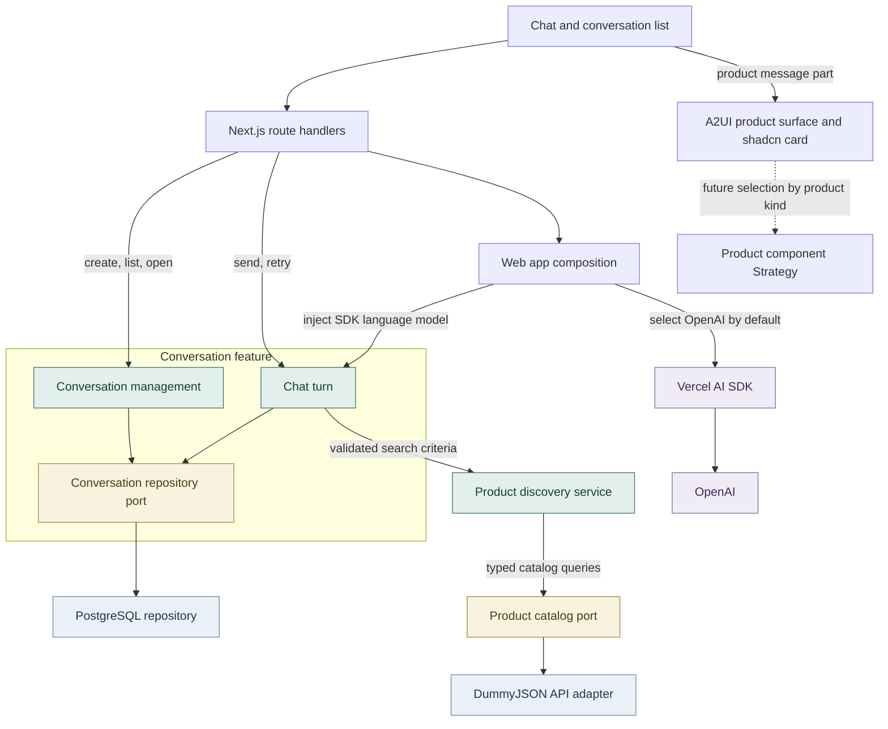

The chat turn interprets a request in the context of its thread. It uses the injected SDK model for intent classification and reply generation. The conversation domain defines OpenAI as the default provider. App composition resolves that value to an SDK language model. A fallback can be configured later. When the intent calls for products, the turn delegates to discovery. Discovery chooses an allowed query, then filters and ranks the candidates. The DummyJSON adapter validates the catalog response, which supplies the titles, prices and images.

A2UI describes a UI surface using data the browser maps to registered components. Here, a versioned product message part selects one registered product card built with shadcn/ui. Live results and saved messages use the same mapping. The future Strategy would choose among cards when a second product presentation earns its place.

## User journeys

### Start a conversation

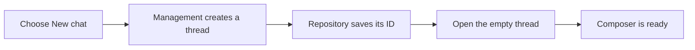

Creating a thread also makes it available in the history list. If creation fails, the UI keeps the current thread open and offers retry.

### Discover products

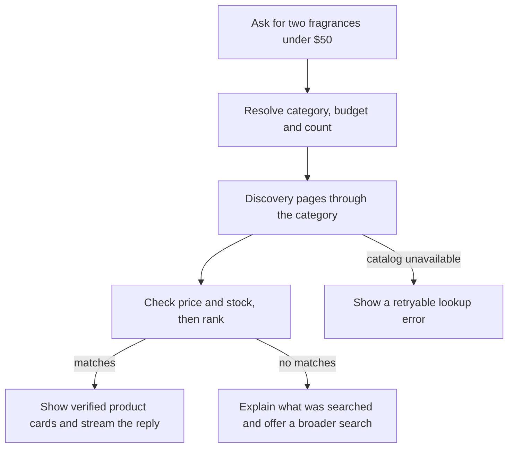

The search and category endpoints support pagination. Budget and stock filters run locally. When a page cap cuts a search short, describe the results as partial. A claim such as “cheapest in the category” requires exhaustive coverage or a provider ordering that proves it.

### Refine an earlier result

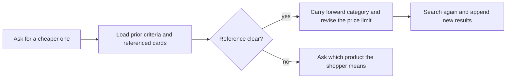

The earlier cards keep the values shown in that turn. Fetch current details by product ID if a follow-up depends on today's price or availability.

### Clarify an ambiguous request

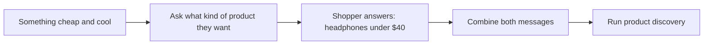

### Handle an off-catalog request

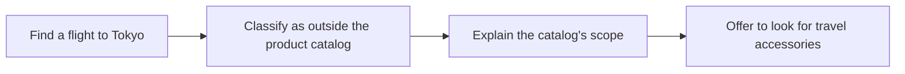

The original request makes zero catalog calls. A later request for travel accessories starts a new discovery turn.

### Search for more than one thing

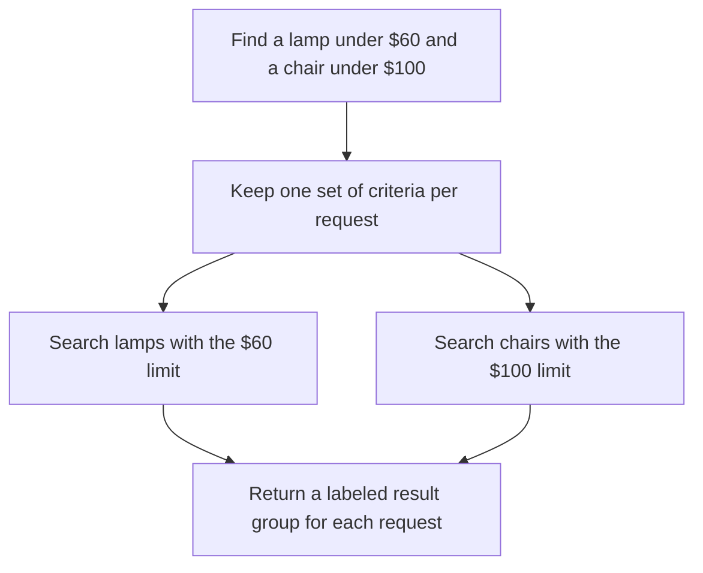

Each group carries its own matches, empty result, or lookup error. If the lamp search succeeds and the chair lookup fails, save both group outcomes in one completed reply. “Try chairs again” starts a new turn with only the chair criteria. The earlier lamp results remain available. This also applies to a single lookup error that the service successfully reports to the shopper.

### Reopen and continue a saved conversation

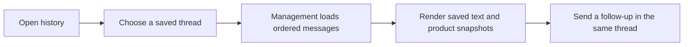

A refresh opens the thread identified in the URL. Reading it requires only PostgreSQL, so reopening old messages works even when the catalog or model provider is unavailable.

### Recover from an interrupted reply

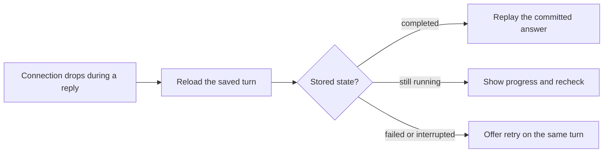

The client supplies a stable turn ID. Repeated submission of that ID returns the saved status. An explicit retry of an interrupted turn starts a new attempt against the same user message. Only the current attempt can commit an answer. A bounded timeout lets an abandoned attempt become retryable.

If a second tab sends a different turn to a busy thread, the server rejects it as busy. The UI keeps the draft and can send it after the first turn finishes. Different conversations can run concurrently. Clearing browser storage leaves the server-side history available. If the app offers an explicit clear action, the proposed behavior is to remove the thread from history, invalidate active attempts, and show a link back to history at its old URL.

## Domain models

These are proposed Zod models and their ownership boundaries. The diagram shows logical relationships. PostgreSQL may store several of these values together in a versioned message payload.

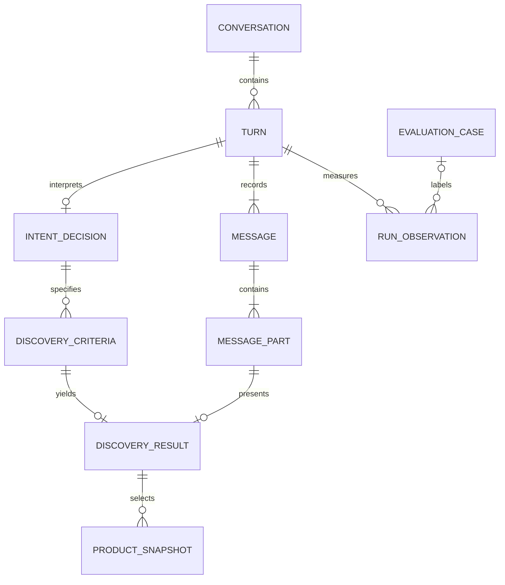

| Owner                   | Models                                | Key fields and rules                                                                                                                                                                                                                                            |
| ----------------------- | ------------------------------------- | --------------------------------------------------------------------------------------------------------------------------------------------------------------------------------------------------------------------------------------------------------------- |
| Conversation management | `Conversation`                        | Stable ID, title, creation time, last activity. List by last activity with an ID tie-breaker.                                                                                                                                                                   |
| Conversation service    | `Turn`, `Message`, `MessagePart`      | A turn has one user message, at most one completed assistant reply, and a run state. Messages have a role and stable order. A part is text or a versioned product result.                                                                                       |
| Product discovery       | `IntentDecision`, `DiscoveryCriteria` | A decision requests discovery, clarification, or an off-catalog reply. Discovery carries one or more criteria sets. Category, keywords, budget, sort and requested count are validated before any lookup.                                                       |
| Catalog and results     | `ProductSnapshot`, `DiscoveryResult`  | A snapshot records a catalog ID, title, description, observed price, stock, image when available, and observation time. A result refers to its criteria and records matches and coverage, or a provider failure.                                                |
| Evaluation              | `RunObservation`, `EvaluationCase`    | One observation per turn attempt with outcome, catalog calls, time to first output, and total duration. A labeled case supplies a prompt and expected intent and constraints independently of the model. Live turns can be measured without an evaluation case. |

Domain packages own schemas and pure rules. Adapters map external payloads into those schemas. Only a completed, validated model decision can trigger a query. Use a fixed catalog host, known paths and supported parameters. Render product snapshots through a registered UI component.

## Infrastructure and streaming

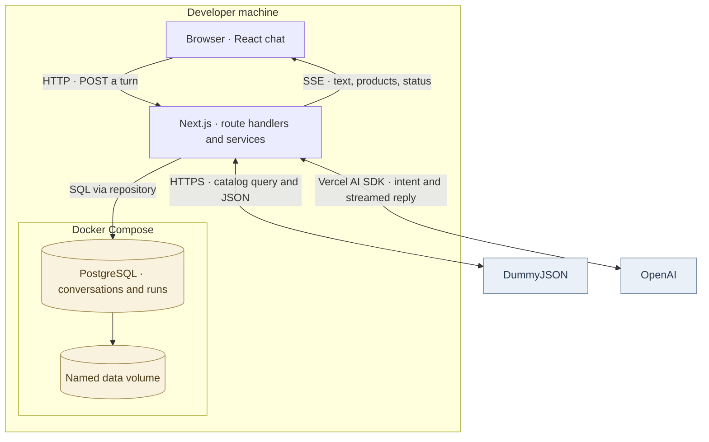

The browser sends a turn with `fetch`. The response to that same POST uses `text/event-stream`. The server saves the user message and turn ID, obtains a validated decision, and retrieves any products. It can emit complete product parts and incremental text while the answer is generated. It commits the final assistant message and marks the turn complete together, then sends the completion event and closes the response. A failed final write yields an error and the UI marks the preview unsaved.

The app assumes one local shopper. Browser requests stay on the local Next.js origin. The server owns the OpenAI key and database connection. The PostgreSQL container uses a named volume so conversations survive a container restart.

## Implementation plan

| Slice                     | Deliverable                                                                                                 | Acceptance check                                                                                                                                                                                                                    |
| ------------------------- | ----------------------------------------------------------------------------------------------------------- | ----------------------------------------------------------------------------------------------------------------------------------------------------------------------------------------------------------------------------------- |
| Contracts and storage     | Zod models, repository port, PostgreSQL migration, thread create/list/load                                  | Create two threads, restart the app, and recover their ordered histories. A corrupt message gives a recoverable error without blocking the other thread.                                                                            |
| One complete turn         | Chat turn, streamed HTTP route, product card, deterministic SDK model and catalog implementations for tests | Playwright sees the first text before the final event, a card with price and image, and the same answer after reload.                                                                                                               |
| Live discovery            | SDK integration with OpenAI for intent and replies, DummyJSON adapter, bounded retrieval, query builder     | Vitest covers ambiguous, off-catalog, multi-intent, out-of-stock, partial and failed lookups. A live smoke test exercises the assignment model and catalog.                                                                         |
| Continuation and recovery | History UI, context for follow-ups, idempotent retry, cancellation and write-failure handling               | After a dropped stream, retry produces one user message and at most one final answer. Clear an active thread and verify it stays cleared.                                                                                           |
| Evaluation and handoff    | Labeled discovery cases, timings and outcomes in PostgreSQL, local results view, submission README          | Report intent accuracy, constraint satisfaction and correct abstention separately from latency. Run the full checks and a fresh local setup. Document observed limitations and two framework trade-offs before the Nov 30 deadline. |

Before implementing discovery, settle the page budget and stale-card refresh interval with representative queries. Before committing to the chat UI integration, build one streamed product card and replay it from a saved message. Those experiments test the two choices most likely to change the plan.
