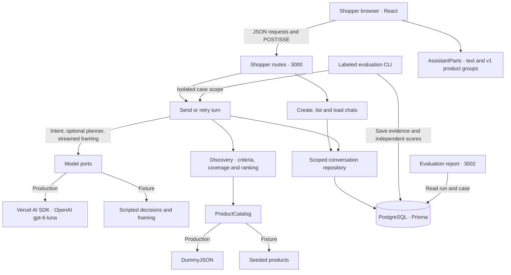
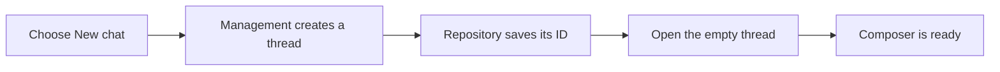
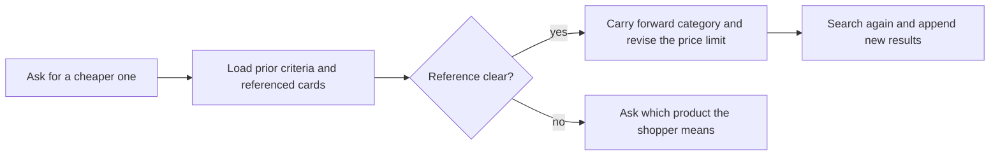
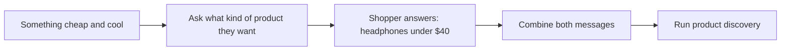
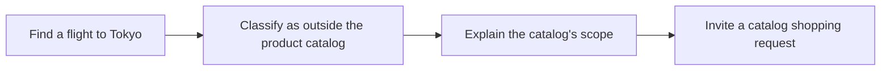
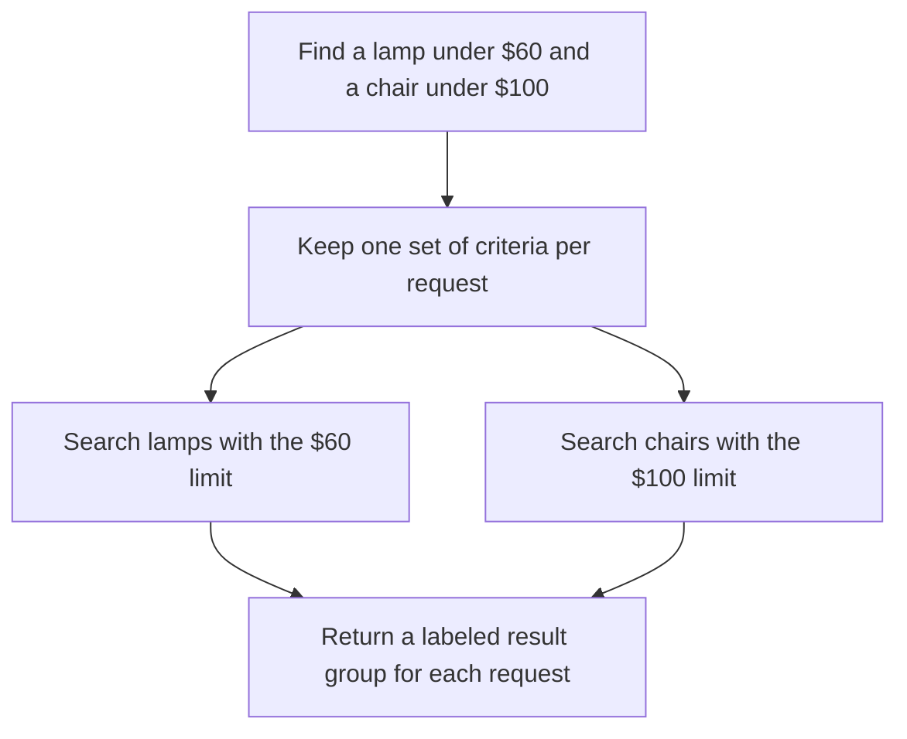
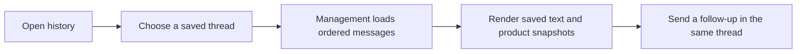
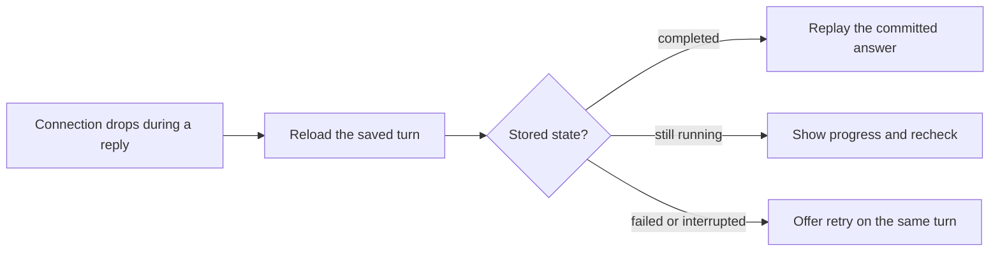
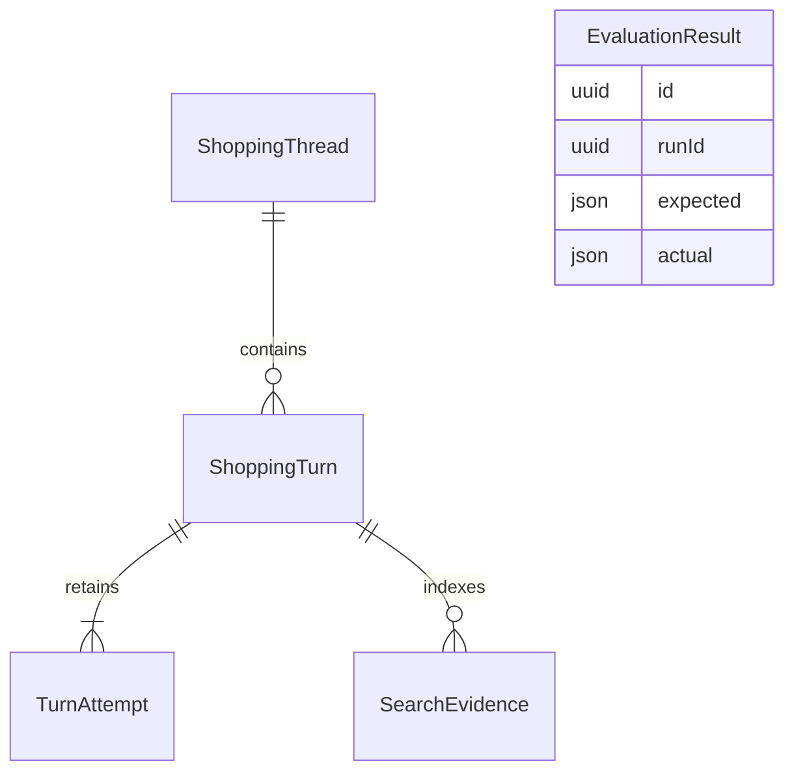

# Shopping copilot architecture

The shopper app serves chat and the evaluation app reads run evidence. Both use local PostgreSQL. Production and fixture builds of the shopper share the same conversation, discovery and storage code. The [delivery plan](delivery-plan.md) preserves the design inputs and the [standalone HTML diagram](architecture.html) includes the original drawings in a historical section.

## Code architecture

[Next configuration](../apps/web/next.config.ts) binds the service module at build time. [Composition](../apps/web/src/server/services.ts) injects the model, planner, clock and catalog into the feature services. The [SDK adapter](../apps/web/src/server/sdk.ts) owns provider-specific calls and validates their structured outputs. A ready search skips planning. For a broad category with relevant same-category history from other threads, the planner proposes a per-turn preference or clarifying question. With no evidence or an invalid proposal the service uses explicit criteria.

A card uses a local versioned message part, shared React primitives and a catalog snapshot. The browser renders the same part from a live event or a saved answer. General A2UI interoperability and a strategy for selecting among multiple card variants remain future possibilities.

## User journeys

### Start a conversation

Creating a thread also makes it available in the history list. If creation fails, the UI keeps the current thread open and offers retry.

### Discover products

The search and category endpoints support pagination. Budget and stock filters run locally. The service marks a capped or inconsistent scan partial. Price ranking applies to observed matches, and the coverage message tells the shopper how much of the category was checked.

### Refine an earlier result

The earlier cards keep the values shown in that turn. Fetch current details by product ID if a follow-up depends on today's price or availability.

### Clarify an ambiguous request

### Handle an off-catalog request

The original request makes zero catalog calls. A later request for travel accessories starts a new discovery turn.

### Search for more than one thing

Each group carries its own matches, empty result, or lookup error. If the lamp search succeeds and the chair lookup fails, save both group outcomes in one completed reply. “Try chairs again” starts a new turn with only the chair criteria. The earlier lamp results remain available. This also applies to a single lookup error that the service successfully reports to the shopper. Expiry of the shared retrieval deadline interrupts the attempt and leaves earlier groups as unsaved previews.

### Reopen and continue a saved conversation

A refresh opens the thread identified in the URL. Reading it requires only PostgreSQL, so reopening old messages works even when the catalog or model provider is unavailable.

### Recover from an interrupted reply

The client supplies a stable turn ID. Repeated submission of that ID returns the saved status. An explicit retry of an interrupted turn starts a new attempt against the same user message. Only the current attempt can commit an answer. A bounded timeout lets an abandoned attempt become retryable.

If a second tab sends a different turn to a busy thread, the server rejects it as busy. The UI keeps the draft and can send it after the first turn finishes. Different conversations can run concurrently. Clearing browser storage leaves the server-side history available. The UI has no delete action.

## Persistence and streaming

A thread contains ordered turns for one scope. Each logical turn stores stable user text and, on completion, its decision and one JSON assistant message with ordered parts. Each generation has a separate attempt row and lease. Search evidence indexes category-specific prior criteria, which other threads in the same scope can use. A labeled result stores its own evidence and scores. [Prisma schema](../packages/adapters/evaluation-store/prisma/schema.prisma)

A new turn streams its status, verified groups and approved text from one POST. The server validates a complete framing sentence before sending it. Adjacent text deltas become one saved paragraph. Only the current lease holder may commit the assistant reply. A successful write precedes the terminal `done` event. Failure after a preview produces an unsaved state and the client reconciles against PostgreSQL. A crashed process can leave timing and call metrics unknown for an expired attempt. [Conversation service](../packages/features/conversation/src/application/chat.ts) · [Browser recovery](../apps/web/src/client/chat-session.ts)

Model and catalog requests happen server-side during live turns. A browser can request an external image URL from a saved card. If the image disappears, the card retains the original product text, price and accessible image fallback. The PostgreSQL named volume survives restarts. The fixture browser journey uses no external requests. [Shopper transport and profiles](../apps/web/README.md) · [Verification and observations](../README.md#verification-and-measured-results)
