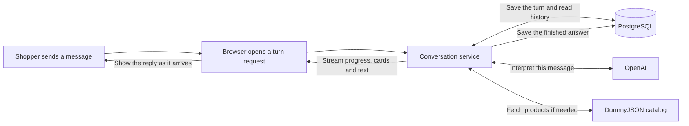
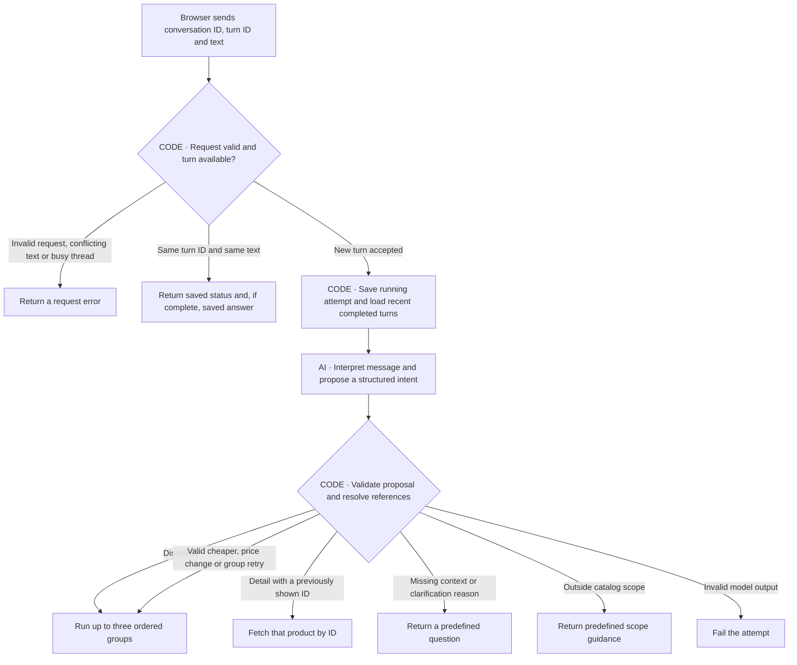
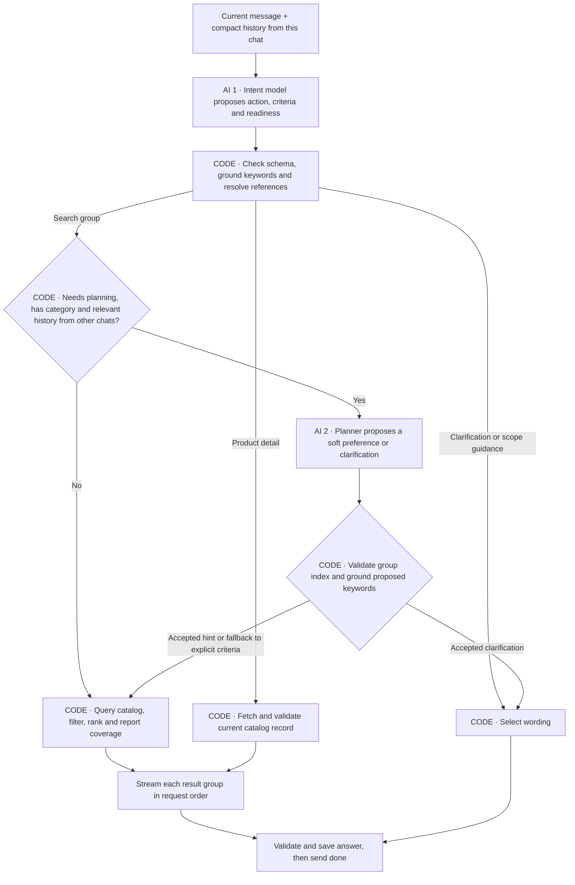
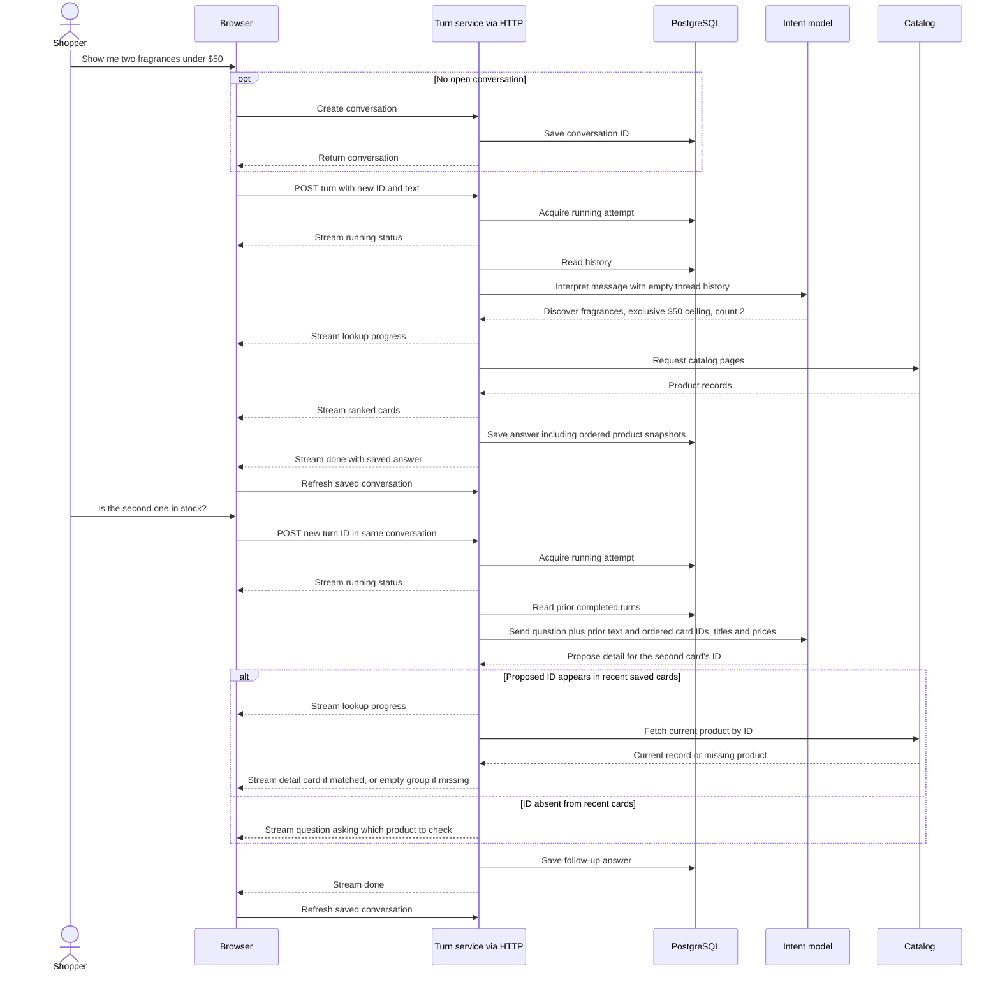
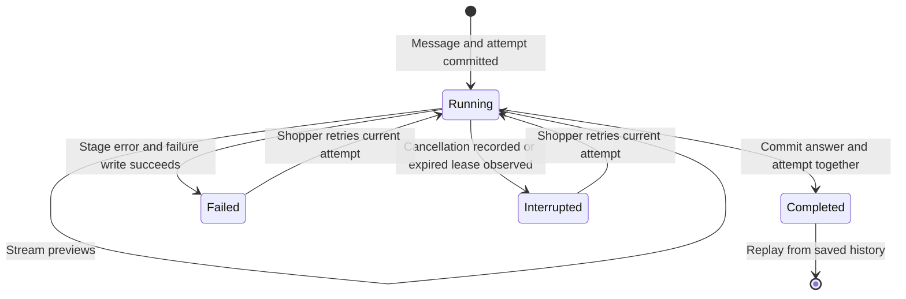

# From a shopper message to a saved answer

Read the four diagrams in order. They trace the production shopper app. The fixture build substitutes scripted model responses and a seeded catalog.

## 1. The round trip

A **turn** pairs one shopper message with its answer. A follow-up creates another turn in the same conversation. For example, “Show me two fragrances under $50” can produce two cards. “Is the second one in stock?” can use the ID on the second saved card to fetch current stock.

## 2. Who makes the first routing decision?

**The first decision about what the shopper means is AI.** The earlier checks deal with whether the server can accept the request. Every newly accepted attempt that reaches interpretation calls the intent model, including follow-ups. The model also proposes whether a search is ready or needs planning. Code checks keywords against the shopper’s words, checks references against saved results, and dispatches the allowed operation. A discovery request can mix search, clarification and off-catalog groups.

[Request acquisition](../packages/adapters/evaluation-store/src/turn-acquisition.ts) · [Turn orchestration](../packages/features/conversation/src/application/chat.ts) · [Proposal checks](../packages/features/conversation/src/application/model-decision.ts)

## 3. Where AI participates inside one turn

The planner can batch eligible groups into one call. Its history contains prior same-category search criteria. A failed planner call falls back to the shopper’s explicit criteria. Within a mixed discovery request, a clarification or scope message streams as its own group before the service moves to the next one.

Product names, prices, stock and cards come from catalog records.

[Model calls and prompts](../apps/web/src/server/sdk.ts) · [Planner eligibility and fallback](../packages/features/conversation/src/application/query-planner.ts) · [Discovery](../packages/features/product-discovery/src/application/discovery.ts) · [Response assembly](../packages/features/conversation/src/application/turn-response.ts)

## 4. Follow one product from the first answer into a follow-up

This example assumes the first search finds two products. The service gives the intent model up to eight earlier completed turns, including shopper text and up to three ordered product groups per turn. The model interprets “second.” Code verifies that the proposed ID appeared in that history. A different previously shown ID would also pass that membership check.

| If the shopper instead says… | What the application does with the model’s proposal                                                                                                                                                             |
| ---------------------------- | --------------------------------------------------------------------------------------------------------------------------------------------------------------------------------------------------------------- |
| “Show me a cheaper one”      | Uses the named card’s saved price, or the lowest displayed price in the single eligible recent group. Searches for one lower-priced match while respecting the previous ceiling. Asks which group if ambiguous. |
| “Actually, above $100”       | For a price-replacement proposal, takes the single previous group’s criteria, removes its old price bounds, applies the proposed new bound and searches again. Asks which group if it cannot resolve one.       |
| “Try that lookup again”      | Checks that the referenced group recorded a lookup error and has reusable criteria, then reruns that group in a new turn.                                                                                       |

**When the stream breaks**, the browser reloads saved conversation history and polls while an attempt is running. A completed answer can be recovered even if its final event never reached the browser. For a failed or interrupted attempt, the Retry button submits the original turn ID and expected attempt number. An accepted retry starts a new attempt on that turn.

[History supplied to the model](../packages/features/conversation/src/application/context.ts) · [Follow-up resolution](../packages/features/conversation/src/application/resolve-references.ts) · [Client submission](../apps/web/src/client/chat-session.ts) · [Stream recovery](../apps/web/src/client/conversation-recovery.ts)

## 5. What survives a failure in diagram 4?

The first durable write saves the shopper's message and opens an attempt. The second commits the complete assistant answer. Between them, the server holds result groups and text in memory and the browser shows a preview. **A shopper can see the second fragrance before the database has saved either card.**

If the server dies, the database can still say **running**. A successful thread load, acquisition or settlement can observe the expired 90-second lease and mark it interrupted. Listing chats alone does not perform this check. There is no background consumer that picks up abandoned work. Retry starts again at intent interpretation. Only earlier **completed** turns supply follow-up context.

### Failure points along the current path

| Where it breaks                                                        | What happens to the turn                                                                                                                                                                                                                                                                                                                           | What the shopper sees or can do                                                                                                                                                           |
| ---------------------------------------------------------------------- | -------------------------------------------------------------------------------------------------------------------------------------------------------------------------------------------------------------------------------------------------------------------------------------------------------------------------------------------------- | ----------------------------------------------------------------------------------------------------------------------------------------------------------------------------------------- |
| Submit or create chat, before acceptance                               | Empty or busy submissions are gated in the UI. Invalid input, disallowed origin, wrong content type, oversized or timed-out body, or missing thread produces an HTTP error before a new attempt starts.                                                                                                                                            | Correct the request or reopen the chat. A storage outage can also prevent creation or loading.                                                                                            |
| Create or send commits, but its acknowledgment is lost                 | Retrying creation with the same conversation ID returns the existing chat. Resending the same turn ID and text returns saved status, plus the answer if complete. The client holds pending IDs in memory.                                                                                                                                          | The mounted client can reconcile or resend safely. After a reload, check history first. Retyping the same text under a new ID creates another turn.                                       |
| Two tabs send or retry concurrently                                    | A per-thread PostgreSQL transaction lock serializes acquisition. A different new turn while one runs gets a busy conflict. Reusing an ID with changed text conflicts. A repeated retry with an old attempt number returns current state. A future number conflicts.                                                                                | A busy send leaves the draft available. A duplicate send while running gets status and can poll history. It does not attach to the original live stream.                                  |
| Loading history, interpreting intent, or validating the decision fails | Unreadable history, missing model credentials, provider errors, intent timeout (20 seconds), or invalid structured output can fail the attempt. An unresolved product reference normally becomes a saved clarification. A plausible but incorrect reference to another displayed ID can pass validation.                                           | The shopper gets an error and can retry after the cause clears, or receives a clarification. A wrong-but-valid choice can look like a successful answer.                                  |
| Preference history or optional AI planner fails                        | Missing evidence skips planning. A planner error, unusable proposal, or planner timeout (8 seconds) falls back to the explicit search criteria while the attempt remains active.                                                                                                                                                                   | The search can finish without personalization. No shopper action is required.                                                                                                             |
| Product search fails                                                   | An ordinary base-page error, including malformed catalog data, yields a lookup-error group. Other groups can continue. An optional preference-page error falls back to the base search. A capped or inconsistent scan reports partial coverage. A retrieval deadline (25 seconds shared across groups) can fail the whole attempt.                 | A saved lookup-error group can be requested again in a new message. Partial coverage and zero matches are reported as search outcomes. A failed attempt instead exposes whole-turn Retry. |
| The stock follow-up reaches the detail endpoint                        | A catalog 404 produces an empty result. Other failures, including a mismatched ID, malformed record, transport error or timeout, propagate to the whole attempt.                                                                                                                                                                                   | A removed product gets a normal “no longer lists” answer. An unavailable detail service gives a failed reply. Earlier completed cards stay in history.                                    |
| Browser cancels, navigates away, or loses the stream                   | Detected cancellation signals the running service and cleanup attempts to record interruption. Malformed, truncated or oversized stream data can terminate the reader. A broken connection races with completion.                                                                                                                                  | Reopen or refresh the chat. A completed turn has its saved answer. An interrupted turn offers Retry. An uncertain preview alone cannot establish either outcome.                          |
| Server crashes or exceeds its overall lease                            | A hard crash can skip cleanup. Expiry is reconciled on later thread access. Settlement checks both the running turn and its attempt number under lock, so a late result cannot overwrite a newer attempt.                                                                                                                                          | The chat may appear busy until expiry is observed. The shopper can then retry. No intermediate group or token is available to resume.                                                     |
| Final validation or database settlement fails                          | Answer, attempt outcome, metrics, search evidence and thread timestamp share a settlement transaction. A rollback leaves no partial completed answer. The service tries to record failure. If that write also fails, the attempt can remain running until expiry. If the commit succeeded but its acknowledgment was lost, the completed row wins. | An error here means the browser should read history. Repeating provider calls before checking could redo an answer already saved.                                                         |
| Final stream event is lost, or history refresh fails                   | The server sends done only after commit. A successful history read recovers the full saved answer. While it sees running, the browser polls with backoff from 250 ms to 2 seconds, with a roughly 93-second polling window. A failed read exits that reconciliation pass.                                                                          | A lost final event alone costs no new model call. An offline browser or database outage leaves status uncertain until a later successful read. Refresh is available if polling stops.     |

**Retry semantics.** Browser mutations and production AI SDK calls have automatic retries disabled. The catalog adapter issues individual reads without a retry loop. Browser polling rereads status. The Retry button creates another attempt for the same failed or interrupted turn. Asking “try that lookup again” creates a new turn targeting one saved lookup-error group. A whole-turn retry may incur new provider costs and produce different products, prices or wording.

[Acquisition and deduplication](../packages/adapters/evaluation-store/src/turn-acquisition.ts) · [Lease expiry and locking](../packages/adapters/evaluation-store/src/thread-access.ts) · [Atomic settlement](../packages/adapters/evaluation-store/src/turn-settlement.ts) · [HTTP errors](../apps/web/src/server/http-failures.ts) · [Stream preview and reconciliation](../apps/web/src/client/turn-preview.ts)

### A recovery design for this shopper

1. **Preserve pending submissions.** Persist pending conversation and turn IDs with the draft across reloads and clear them after reconciliation. Make pending, saved and interrupted results visibly distinct. These changes address accidental duplicate sends. They still leave a crash window before the answer commit.
2. **If an accepted turn should finish after the shopper leaves, give execution to a durable worker.** In the transaction that accepts the message, also make work available to a worker. The simplest option here is a job row in the existing PostgreSQL database. The browser subscribes to progress. Disconnecting ends the subscription. An explicit cancel action would stop execution. This trades additional background work and cost for completion independent of the browser.
3. **Checkpoint at boundaries the shopper can recognize.** Persist the validated intent and the inputs it depended on, then each completed result group with its ordered snapshots. Commit a group before publishing its cards. Give each group a stable key and each progress event a sequence number. A recovering worker reuses committed groups and starts at the first unfinished group. A reconnecting browser loads saved progress and deduplicates later events. This preserves the identity of “the second one” across a restart.
4. **Bound replay and fence stale writers.** Claim jobs with expiring leases and an ownership generation. Fence every checkpoint and final write by that generation. Retry transient network failures, rate limits and eligible server errors with backoff, jitter and a finite budget. Respect provider retry delays. Surface permanent errors such as invalid configuration immediately. When the budget runs out, persist a terminal failure and the available recovery action. Keep collecting worker lag, stale leases, retries per stage and elapsed time until the shopper sees a terminal state.
5. **Make the delivery guarantee explicit.** A worker may call a provider twice if it dies after receiving the result but before committing the checkpoint. Stable keys and fenced writes can give the shopper one saved result per group even when upstream work repeats. For a stock follow-up, save the observation time with the result. An explicit request to refresh stock starts a new observation.

**Acceptance cases for that design:** drop the create/send acknowledgment and reload the browser; kill the worker after intent, after the first committed group, and after final commit but before notification; race two workers after lease expiry; disconnect during the stock lookup; inject provider throttling, a permanent configuration error, and a database outage. Check the actual shopper transcript as well as database state: one turn per submission key, stable card order and IDs, bounded retries, one terminal outcome, and recovery without a second Send after connectivity returns.
